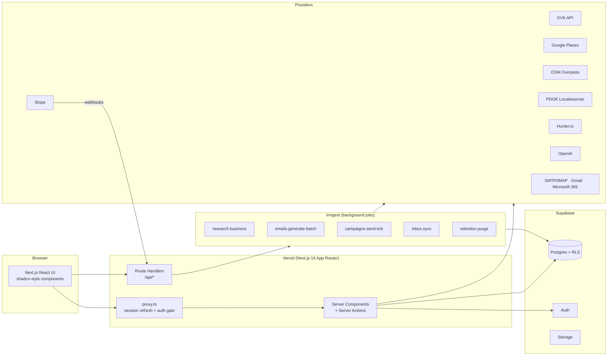

# Leadwerk — Architecture

Leadwerk is a multi-tenant SaaS that lets agencies discover Dutch businesses,
research each one individually with AI, generate an individually written email
per business, send it through a compliance gate, and manage replies in a CRM.

## 1. System overview

## 2. Layers

| Layer | Location | Responsibility |
|---|---|---|
| UI | `src/app/(app)/*`, `src/components/*` | Pages, forms, tables. Client components only where interactivity is needed. |
| Data access layer | `src/server/auth.ts` | Resolves the user, active workspace and role. Every page/action calls it. |
| Domain services | `src/server/{discovery,research,scoring,emails,compliance,sending,inbox,billing}` | Pure-ish business logic; unit tested with mocked providers. |
| Provider adapters | `src/server/providers/*` | One interface per provider type, a live and a mock implementation each. |
| Jobs | `src/inngest/*` | Long-running, retried, rate-limited work. Thin wrappers around domain services. |
| Database | `supabase/migrations/*` | Schema, RLS policies, guard triggers, RPC functions. |

## 3. Multi-tenancy & security model

* **Tenant = organization (agency workspace).** Every tenant table carries `org_id`.
* **RLS everywhere.** Policies are generated by `private.apply_tenant_policies()`
  with a minimum role per operation (`owner > admin > manager > sales_rep > viewer`).
  Membership is resolved once per statement via `private.org_ids(min_role)`.
* **Composite foreign keys** `(org_id, x_id) → parent(org_id, id)` make it
  impossible to reference another tenant's rows, even by guessing ids
  (foreign-key checks bypass RLS, so this matters).
* **System-managed columns** (`generated_emails.compliance_status`,
  `campaigns.status`, `is_mock`, delivery tables) are protected by guard
  triggers: browser clients cannot change them, only the service role.
* **Secrets** (mailbox credentials, integration tokens) live in separate tables
  with RLS enabled, no policies and no grants → service role only, and are
  encrypted at rest with AES-256-GCM (`ENCRYPTION_KEY`).
* **Two Supabase clients:** user-scoped (RLS enforced) for user actions; the
  service-role client only in jobs/webhooks, always filtering by `org_id`.
* **Untrusted web content** is never placed in system prompts, is delimited and
  labelled as data, and outputs are schema-validated (see §6).

## 4. Data model (ERD)

```mermaid
erDiagram
  organizations ||--o{ organization_members : has
  users ||--o{ organization_members : joins
  organizations ||--|| subscriptions : billed_by
  plans ||--o{ subscriptions : defines
  organizations ||--o{ usage_records : consumes
  organizations ||--o{ agency_clients : serves
  organizations ||--o{ businesses : owns

  businesses ||--o{ business_locations : "establishments (vestigingen)"
  businesses ||--o{ business_trade_names : "trade names"
  businesses ||--o{ websites : has
  businesses ||--o{ contacts : employs
  businesses ||--o{ business_sources : "retrieved from"
  businesses ||--o{ business_attributes : "field provenance"
  contacts ||--o{ contact_sources : "found via"

  businesses ||--o{ website_analyses : researched_by
  website_analyses ||--o{ opportunities : yields
  businesses ||--o{ lead_scores : scored

  agency_profiles ||--o{ email_generation_batches : drives
  email_generation_batches ||--o{ generated_emails : produces
  businesses ||--o{ generated_emails : "one per step"
  generated_emails ||--o{ generated_email_revisions : history

  campaigns ||--o{ campaign_recipients : targets
  campaign_recipients ||--o{ outbound_messages : "one per step"
  email_accounts ||--o{ outbound_messages : sends
  outbound_messages ||--o{ email_events : tracked_by
  conversations ||--o{ replies : contains
  campaign_recipients ||--o| conversations : "reply thread"

  organizations ||--o{ email_permissions : documents
  organizations ||--o{ suppression_records : blocks
  organizations ||--o{ audit_logs : records
  businesses ||--o{ tasks : has
  businesses ||--o{ notes : has
  businesses ||--o{ activities : timeline
```

**Entity distinctions** (never conflated):

| Concept | Table | Key |
|---|---|---|
| Legal company | `businesses` | `kvk_number` (8 digits) |
| Establishment | `business_locations` | `establishment_number` (12 digits), `google_place_id`, `osm_id` |
| Trade name | `business_trade_names` | name per company/location |
| Website | `websites` | domain per company, with verification status |
| Contact | `contacts` | email per org; `recipient_category` drives compliance |

**Provenance:** every retrieval is a `business_sources` row (provider, external
id, retrieval time, retention class, expiry, exportability, attribution); each
field value per provider is a `business_attributes` row with verification status
and expiry. The golden record on `businesses` is derived from these.

## 5. Key flows

### Discovery → import → dedup
1. User searches (KVK / Google Places / OSM) — results are shown live, not stored.
2. Selected results are imported: the server re-fetches details by identifier,
   then the deduplication engine (`src/server/discovery/dedupe.ts`) matches:
   KVK number → same company; establishment number / place id / OSM id → same
   location; domain + postcode or name + postcode + house number → probable match.
   Conflicting KVK/establishment numbers **never** merge.
3. Provenance and retention metadata are written per field.

### Research → opportunities → score
Website crawl (SSRF-safe, robots-aware, few pages) → deterministic signals
(SSL, viewport, booking/ordering/forms/chat detection, copyright year) → AI
research with structured output separating **observations** (with quotes and
URLs) from **hypotheses** → opportunities → weighted lead score with per-factor
reasons and evidence.

### Individual email generation (core feature)
Batch → Inngest fan-out (one step per business, concurrency-limited, retried,
idempotent on `(org, business, profile, step, campaign)`) → per business: load
profile + analysis → choose opportunity matching agency services → write email +
alternative → **fact-check** every factual claim against the evidence → store as
`pending` review. Credits are consumed with idempotency keys.

### Sending
Campaign launch validates every recipient through the **eligibility gate**; a
tick job claims due recipients (`claim_due_recipients`, `FOR UPDATE SKIP LOCKED`),
re-checks eligibility, enforces account/campaign rate limits and sending windows,
inserts one `outbound_messages` row per (recipient, step) (unique constraint =
duplicate-send guarantee), sends individually (never CC/BCC) with
`List-Unsubscribe` headers, and schedules the next follow-up. Replies,
unsubscribes, bounces and suppression stop the sequence.

## 6. AI design

* Separate prompt modules for research, classification, scoring, email writing
  and reply categorisation (`src/server/ai/prompts/*`), each versioned.
* Structured outputs validated with Zod; invalid output → retry → fail visibly.
* Models configurable per task (`OPENAI_MODEL_*`).
* **Prompt-injection defence:** website text is sanitised, truncated, wrapped in
  `<untrusted_website_content>` delimiters and explicitly declared as data; the
  model is never given tools or secrets; instructions found in content are
  reported, not followed; outputs are schema-checked and fact-checked.
* Cost tracking per call in `api_usage` (tokens × configured price).

## 7. Compliance architecture

* `email_permissions`: documented legal basis per address (basis, evidence,
  source, date, purpose, recipient category, expiry, revocation).
* `suppression_records`: unsubscribes, objections, hard bounces, complaints,
  deletion requests (address or whole domain).
* **Hard eligibility gate** (`src/server/compliance/eligibility.ts`) — sending is
  blocked unless every rule passes; each block carries a human-readable reason.
  KVK `indNonMailing = Ja` is a hard block. Generic addresses are never
  automatically eligible.
* Data-subject requests, privacy notice footer, retention purge job, audit log
  triggers on compliance-relevant tables.
* Users remain responsible for their campaigns; the product does not give legal advice.

## 8. Architecture decision records

* **ADR-001 Supabase + RLS as the authorization backbone.** Tenant isolation is
  enforced in the database, not only in application code.
* **ADR-002 Inngest for background jobs.** Native Vercel integration, step-level
  retries, concurrency keys per org, cron, idempotency.
* **ADR-003 Cache Components disabled.** All app pages are per-user and
  RLS-scoped; dynamic rendering keeps auth simple and correct.
* **ADR-004 Connected mailboxes first.** Transactional ESPs (Resend, Postmark,
  SendGrid) prohibit cold outreach; the sending layer is an adapter interface
  (SMTP/IMAP, Gmail API, Microsoft Graph, mock) so a dedicated outbound
  provider can be added without touching campaign logic. No automatic
  domain/account rotation.
* **ADR-005 Google Places data is not persisted beyond what the terms allow.**
  Only `place_id` is kept permanently; Google-sourced coordinates and content
  carry an expiry and are purged by the retention job; Google-sourced points are
  not drawn on the non-Google (Leaflet/OSM) map.
* **ADR-006 shadcn-style components written in-repo** on Radix primitives
  (the shadcn registry is not reachable from the build sandbox).
